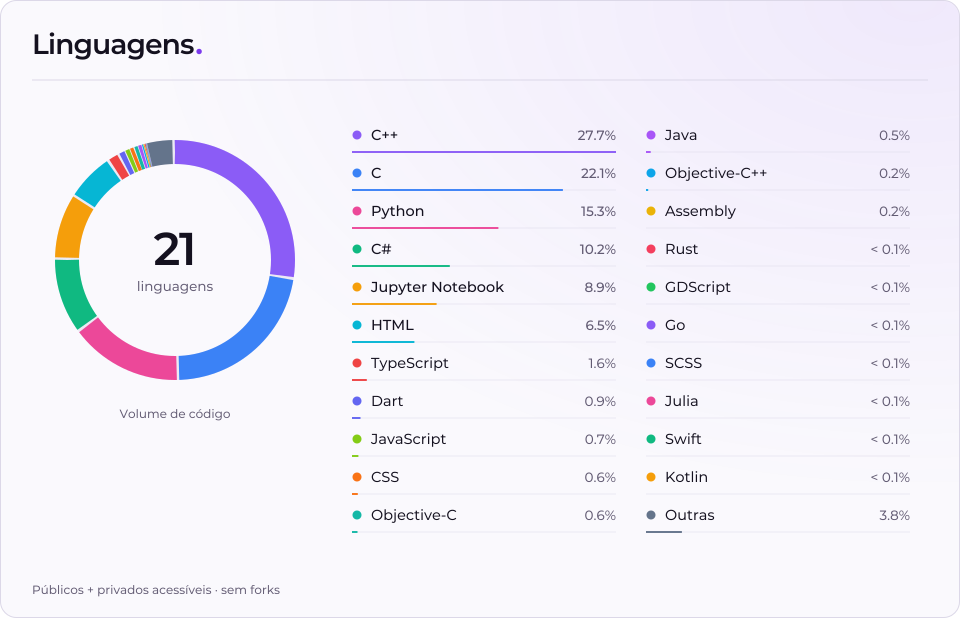
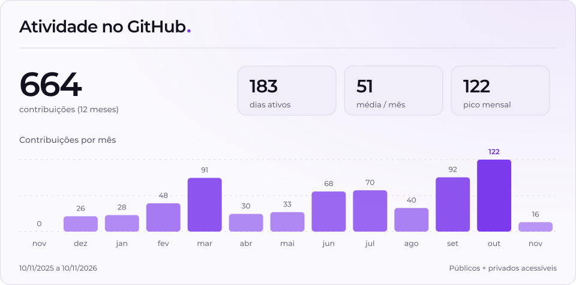

# Oi, eu sou o Lorhan 👋

[lorhan.com.br](https://www.lorhan.com.br) · [gabriel@lorhan.com.br](mailto:gabriel@lorhan.com.br)

<picture>
  <source media="(max-width: 600px) and (prefers-color-scheme: dark)" srcset="assets/stats/languages-dark-mobile.svg">
  <source media="(max-width: 600px)" srcset="assets/stats/languages-light-mobile.svg">
  <source media="(prefers-color-scheme: dark)" srcset="assets/stats/languages-dark.svg">
  
</picture>

 
 

<picture>
  <source media="(max-width: 600px) and (prefers-color-scheme: dark)" srcset="assets/stats/activity-dark-mobile.svg">
  <source media="(max-width: 600px)" srcset="assets/stats/activity-light-mobile.svg">
  <source media="(prefers-color-scheme: dark)" srcset="assets/stats/activity-dark.svg">
  
</picture>

